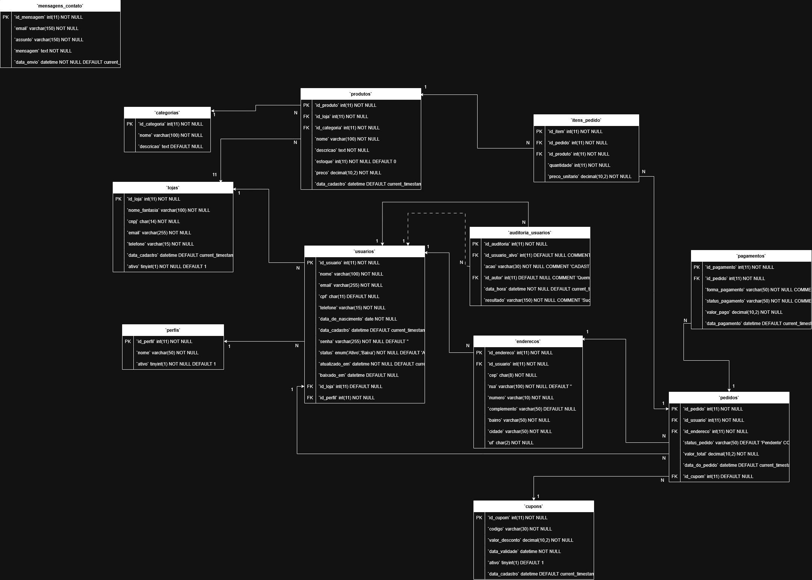

# Banco de dados 

Banco `wattgym` (MySQL/MariaDB, charset `utf8mb4`, mecanismo InnoDB). Script de criação: `database/WattGYM.sql`.

## DER



Como ler: `PK` é a chave primária, `FK` é a chave estrangeira e `UK` é um valor que não pode se repetir. Cada linha liga o lado **1** ao lado **N**.

- Cada **usuário** tem um **perfil** (cliente, admin ou atendente) e, opcionalmente, um **setor** (a tabela `lojas`). Um perfil e um setor podem ter vários usuários.
- Um **usuário** tem vários **endereços** e faz vários **pedidos**.
- Cada **pedido** é entregue em um **endereço** e pode usar um **cupom** (opcional).
- Um **pedido** contém vários **itens**, e um **produto** aparece em vários itens. A tabela `itens_pedido` é a ponte entre `pedidos` e `produtos` (relação N:N).
- Um **pedido** pode ter vários **pagamentos**.
- Cada **produto** pertence a uma **loja** e a uma **categoria**.
- `auditoria_usuarios` guarda o histórico de cadastros e baixas. Cada linha aponta para o usuário que sofreu a ação e, quando existe, para quem executou (linha tracejada).
- `mensagens_contato` não se liga a nenhuma outra tabela: guarda o que chega pela página de contato.

## Resumo das tabelas

| Tabela | Para que serve |
|--------|----------------|
| `usuarios` | Pessoas cadastradas (clientes, atendentes e administradores) |
| `perfis` | Perfis de acesso: cliente, admin e atendente |
| `auditoria_usuarios` | Histórico de cadastros e baixas de usuários |
| `enderecos` | Endereços de entrega dos usuários |
| `pedidos` | Pedidos feitos pelos usuários |
| `itens_pedido` | Produtos de cada pedido |
| `pagamentos` | Pagamentos de cada pedido |
| `cupons` | Cupons de desconto |
| `produtos` | Catálogo de produtos à venda |
| `categorias` | Categorias dos produtos |
| `lojas` | Lojas vendedoras |
| `mensagens_contato` | Mensagens enviadas pela página de contato |

## Dicionário de dados

### usuarios

Pessoas cadastradas no site. O `perfil` define o que a pessoa pode fazer (só `admin` acessa o dashboard e a gestão de usuários). O `status` indica se ela está em uso (`Ativo`) ou foi excluída logicamente (`Baixa`).

| Coluna | Tipo | Obrigatório | Chave | Descrição |
|--------|------|-------------|-------|-----------|
| id_usuario | INT, AUTO_INCREMENT | Sim | PK | Número único do usuário |
| nome | VARCHAR(100) | Sim | — | Nome completo |
| email | VARCHAR(255) | Sim | UK | E-mail usado para entrar no site. Não pode se repetir, nem entre ativos e em Baixa |
| cpf | CHAR(11) | Não | UK | CPF, só números. Fica vazio (`NULL`) até a pessoa preencher no perfil |
| telefone | VARCHAR(15) | Sim | — | Telefone/WhatsApp com DDD, no formato `(81) 99999-9999`. Fica vazio até a pessoa preencher |
| data_de_nascimento | DATE | Sim | — | Data de nascimento |
| senha | VARCHAR(255) | Sim | — | Senha criptografada com `password_hash()`. Nunca guarda a senha pura |
| id_perfil | INT | Sim | FK → perfis.id_perfil | Perfil de acesso do usuário. O cadastro pelo site sempre cria `cliente` |
| id_loja | INT | Não | FK → lojas.id_loja | Setor (loja) do usuário. Fica vazio para quem se cadastra pelo site |
| status | ENUM('Ativo','Baixa') | Sim | — | Situação do usuário. Padrão: `'Ativo'`. Só usuários `Ativo` aparecem na lista e conseguem entrar |
| data_cadastro | DATETIME | Não | — | Data e hora do cadastro (é o "criado em" da sprint). Padrão: horário atual |
| atualizado_em | DATETIME | Sim | — | Data e hora da última alteração. O MySQL atualiza sozinho a cada mudança |
| baixado_em | DATETIME | Não | — | Data e hora da baixa. Fica vazio (`NULL`) enquanto o usuário está Ativo |

### enderecos

Endereços de entrega. Se o usuário for apagado, os endereços dele também são (`ON DELETE CASCADE`).

| Coluna | Tipo | Obrigatório | Chave | Descrição |
|--------|------|-------------|-------|-----------|
| id_endereco | INT, AUTO_INCREMENT | Sim | PK | Número único do endereço |
| id_usuario | INT | Sim | FK → usuarios.id_usuario | Dono do endereço |
| cep | CHAR(8) | Sim | — | CEP, só números |
| rua | VARCHAR(100) | Sim | — | Nome da rua. Padrão: vazio |
| numero | VARCHAR(10) | Sim | — | Número da casa ou prédio |
| complemento | VARCHAR(50) | Não | — | Apartamento, bloco, "casa 2" etc. |
| bairro | VARCHAR(50) | Sim | — | Bairro |
| cidade | VARCHAR(50) | Sim | — | Cidade |
| uf | CHAR(2) | Sim | — | Sigla do estado, como `PE` |

### pedidos

| Coluna | Tipo | Obrigatório | Chave | Descrição |
|--------|------|-------------|-------|-----------|
| id_pedido | INT, AUTO_INCREMENT | Sim | PK | Número único do pedido |
| id_usuario | INT | Sim | FK → usuarios.id_usuario | Cliente que fez o pedido |
| id_endereco | INT | Sim | FK → enderecos.id_endereco | Endereço de entrega |
| id_cupom | INT | Não | FK → cupons.id_cupom | Cupom usado. `NULL` se não usou |
| status_pedido | VARCHAR(50) | Não | — | Situação do pedido: `Pendente`, `Pago`, `Em Transporte`, `Entregue` ou `Cancelado`. Padrão: `'Pendente'` |
| valor_total | DECIMAL(10,2) | Sim | — | Valor total em reais, já com desconto |
| data_do_pedido | DATETIME | Não | — | Data e hora do pedido. Padrão: horário atual |

### itens_pedido

Se o pedido for apagado, os itens dele também são (`ON DELETE CASCADE`).

| Coluna | Tipo | Obrigatório | Chave | Descrição |
|--------|------|-------------|-------|-----------|
| id_item | INT, AUTO_INCREMENT | Sim | PK | Número único do item |
| id_pedido | INT | Sim | FK → pedidos.id_pedido | Pedido a que o item pertence |
| id_produto | INT | Sim | FK → produtos.id_produto | Produto comprado |
| quantidade | INT | Sim | — | Quantas unidades |
| preco_unitario | DECIMAL(10,2) | Sim | — | Preço de uma unidade **no dia da compra**. Fica guardado aqui porque o preço do produto pode mudar depois, e o pedido antigo não pode mudar junto |

### pagamentos

Se o pedido for apagado, os pagamentos dele também são (`ON DELETE CASCADE`).

| Coluna | Tipo | Obrigatório | Chave | Descrição |
|--------|------|-------------|-------|-----------|
| id_pagamento | INT, AUTO_INCREMENT | Sim | PK | Número único do pagamento |
| id_pedido | INT | Sim | FK → pedidos.id_pedido | Pedido pago |
| forma_pagamento | VARCHAR(50) | Sim | — | `Pix`, `Cartao_Credito`, `Cartao_Debito` ou `Boleto` |
| status_pagamento | VARCHAR(50) | Sim | — | `Pendente`, `Aprovado` ou `Recusado` |
| valor_pago | DECIMAL(10,2) | Sim | — | Valor pago, em reais |
| data_pagamento | DATETIME | Não | — | Data e hora do pagamento. Padrão: horário atual |

### cupons

| Coluna | Tipo | Obrigatório | Chave | Descrição |
|--------|------|-------------|-------|-----------|
| id_cupom | INT, AUTO_INCREMENT | Sim | PK | Número único do cupom |
| codigo | VARCHAR(30) | Sim | UK | Código digitado pelo cliente, como `WATT10` |
| valor_desconto | DECIMAL(10,2) | Sim | — | Valor do desconto |
| data_validade | DATETIME | Sim | — | Até quando o cupom vale |
| ativo | TINYINT(1) | Não | — | `1` = pode ser usado, `0` = desativado. Padrão: `1` |
| data_cadastro | DATETIME | Não | — | Data e hora de criação. Padrão: horário atual |

### produtos

| Coluna | Tipo | Obrigatório | Chave | Descrição |
|--------|------|-------------|-------|-----------|
| id_produto | INT, AUTO_INCREMENT | Sim | PK | Número único do produto |
| id_loja | INT | Sim | FK → lojas.id_loja | Loja que vende o produto |
| id_categoria | INT | Sim | FK → categorias.id_categoria | Categoria do produto |
| nome | VARCHAR(100) | Sim | — | Nome exibido no catálogo |
| descricao | TEXT | Sim | — | Descrição do produto |
| estoque | INT | Sim | — | Unidades disponíveis. Padrão: `0` |
| preco | DECIMAL(10,2) | Sim | — | Preço atual, em reais |
| data_cadastro | DATETIME | Não | — | Data e hora do cadastro. Padrão: horário atual |

### categorias

| Coluna | Tipo | Obrigatório | Chave | Descrição |
|--------|------|-------------|-------|-----------|
| id_categoria | INT, AUTO_INCREMENT | Sim | PK | Número único da categoria |
| nome | VARCHAR(100) | Sim | UK | Nome da categoria, como `Creatinas` |
| descricao | TEXT | Não | — | O que a categoria reúne |

### lojas

| Coluna | Tipo | Obrigatório | Chave | Descrição |
|--------|------|-------------|-------|-----------|
| id_loja | INT, AUTO_INCREMENT | Sim | PK | Número único da loja |
| nome_fantasia | VARCHAR(100) | Sim | — | Nome da loja |
| cnpj | CHAR(14) | Sim | UK | CNPJ, só números |
| email | VARCHAR(255) | Sim | — | E-mail de contato da loja |
| telefone | VARCHAR(15) | Sim | — | Telefone da loja |
| ativo | TINYINT(1) | Sim | — | `1` = aparece como opção de setor nos formulários, `0` = escondida. Padrão: `1` |
| data_cadastro | DATETIME | Não | — | Data e hora do cadastro. Padrão: horário atual |

### perfis

Tabela de referência dos perfis de acesso.

| Coluna | Tipo | Obrigatório | Chave | Descrição |
|--------|------|-------------|-------|-----------|
| id_perfil | INT, AUTO_INCREMENT | Sim | PK | Número único do perfil |
| nome | VARCHAR(50) | Sim | UK | Nome do perfil: `cliente`, `admin` ou `atendente` |
| ativo | TINYINT(1) | Sim | — | `1` = aparece como opção no formulário de usuário, `0` = escondido. Padrão: `1` |

### auditoria_usuarios

Histórico das ações sobre usuários. Nunca guarda senha, e-mail nem outros dados pessoais: só os números de identificação, o nome da ação e o resultado.

| Coluna | Tipo | Obrigatório | Chave | Descrição |
|--------|------|-------------|-------|-----------|
| id_auditoria | INT, AUTO_INCREMENT | Sim | PK | Número único do registro |
| id_usuario_alvo | INT | Não | FK → usuarios.id_usuario | Usuário que sofreu a ação. Vazio se a tentativa foi sobre um usuário que não existe ou um cadastro rejeitado |
| acao | VARCHAR(30) | Sim | — | `CADASTRO` ou `BAIXA` |
| id_autor | INT | Não | FK → usuarios.id_usuario | Quem executou a ação. Vazio no cadastro feito pelo próprio visitante |
| data_hora | DATETIME | Sim | — | Quando aconteceu. Padrão: horário atual |
| resultado | VARCHAR(150) | Sim | — | `Sucesso` ou o motivo da rejeição, como `Rejeitado: usuário já estava em Baixa` |

### mensagens_contato

Mensagens enviadas pelo formulário da página de contato.

| Coluna | Tipo | Obrigatório | Chave | Descrição |
|--------|------|-------------|-------|-----------|
| id_mensagem | INT, AUTO_INCREMENT | Sim | PK | Número único da mensagem |
| email | VARCHAR(150) | Sim | — | E-mail de quem enviou, para a resposta |
| assunto | VARCHAR(150) | Sim | — | Assunto escrito pela pessoa |
| mensagem | TEXT | Sim | — | Texto da mensagem (até 2000 caracteres no formulário) |
| data_envio | DATETIME | Sim | — | Data e hora do envio. Padrão: horário atual |

## Como o banco foi alterado na Sprint 01

O script `WattGYM.sql` original não tem as colunas e tabelas abaixo. Elas são criadas pelo arquivo **`database/sprint01.sql`**, que deve ser importado depois do original. O script pode ser executado mais de uma vez sem dar erro, e traz dados fictícios de teste (senha `123456`).

- `usuarios`: novas colunas `senha`, `status`, `atualizado_em`, `baixado_em`, `id_loja` e `id_perfil`. O CPF passou a aceitar `NULL`, porque tem índice `UNIQUE` e o cadastro não pede CPF (texto vazio se repetiria).
- A coluna antiga `tipo` (cliente ou admin) foi trocada pela chave estrangeira `id_perfil`. O script converte os valores que já existiam e apaga a coluna.
- Novas tabelas: `perfis`, `auditoria_usuarios` e `mensagens_contato`.
- `lojas.ativo` e `enderecos.rua`.

### Correspondência com o modelo de referência da sprint

| Modelo da sprint | No WattGYM |
|------------------|------------|
| `usuarios.id` | `usuarios.id_usuario` |
| `setores` (tabela de referência) | `lojas`, ligada por `usuarios.id_loja` |
| `perfis` | `perfis`, ligada por `usuarios.id_perfil` |
| `criado_em` | `data_cadastro` |
| `auditoria_usuarios` | `auditoria_usuarios` (o autor é `id_autor`) |

### O JOIN de usuários, perfis e setores

```sql
SELECT u.id_usuario, u.nome, u.email, p.nome AS perfil, l.nome_fantasia AS setor
FROM usuarios u
JOIN perfis p ON p.id_perfil = u.id_perfil
LEFT JOIN lojas l ON l.id_loja = u.id_loja
WHERE u.status = 'Ativo';
```

- `ON p.id_perfil = u.id_perfil`: liga cada usuário ao seu perfil pela chave estrangeira. Todo usuário tem perfil (a coluna é obrigatória), então basta o `JOIN` comum.
- `ON l.id_loja = u.id_loja`: liga o usuário ao seu setor. O `LEFT JOIN` é necessário porque o setor é opcional: quem se cadastra pelo site não tem setor, e com `JOIN` comum essa pessoa sumiria da lista.
- Cada usuário aparece uma única vez, porque cada chave estrangeira aponta para uma só linha da tabela de referência.

**Por que não guardar o nome do perfil e do setor dentro de `usuarios`?** Se o nome fosse copiado em cada usuário, renomear um setor exigiria alterar todas as linhas dele, e uma linha esquecida deixaria o mesmo setor com dois nomes diferentes (anomalia de atualização). Com a chave estrangeira, o nome existe em um só lugar e a listagem sempre mostra o valor atual. O teste T07 do relatório da sprint comprova isso.

## Padrão de nomes

- Tabelas no plural e em minúsculas: `usuarios`, `pedidos`.
- Colunas em `snake_case`: `data_do_pedido`, `preco_unitario`.
- Chave primária e estrangeira no formato `id_` + nome da tabela no singular: `id_usuario`, `id_produto`.
- Sem acento e sem espaço em nomes de tabelas e colunas.
