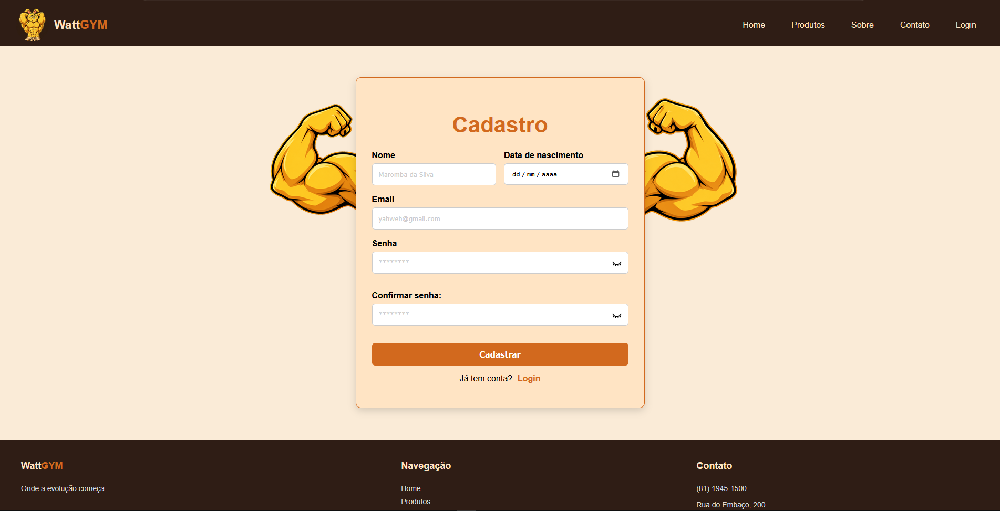
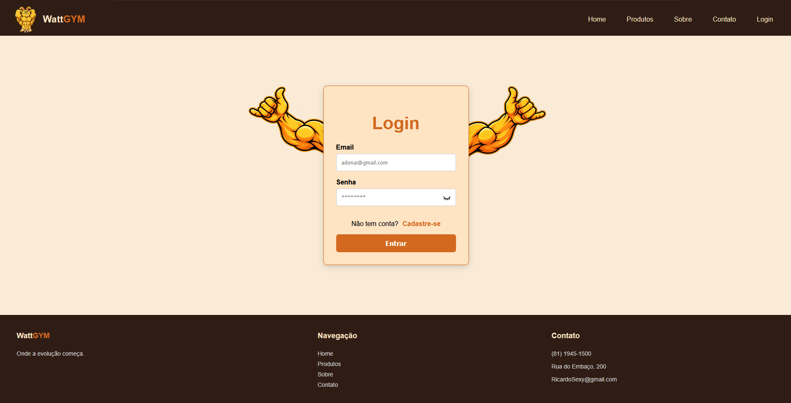
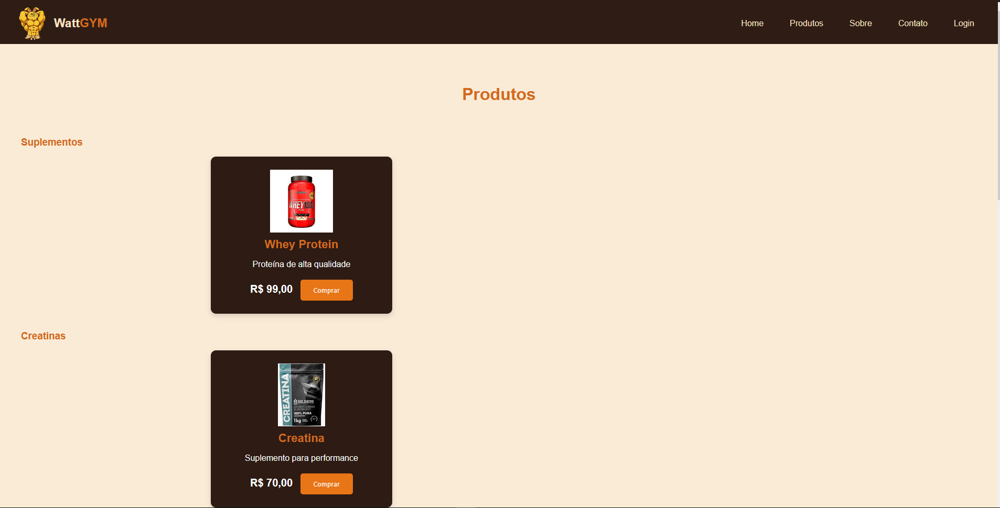
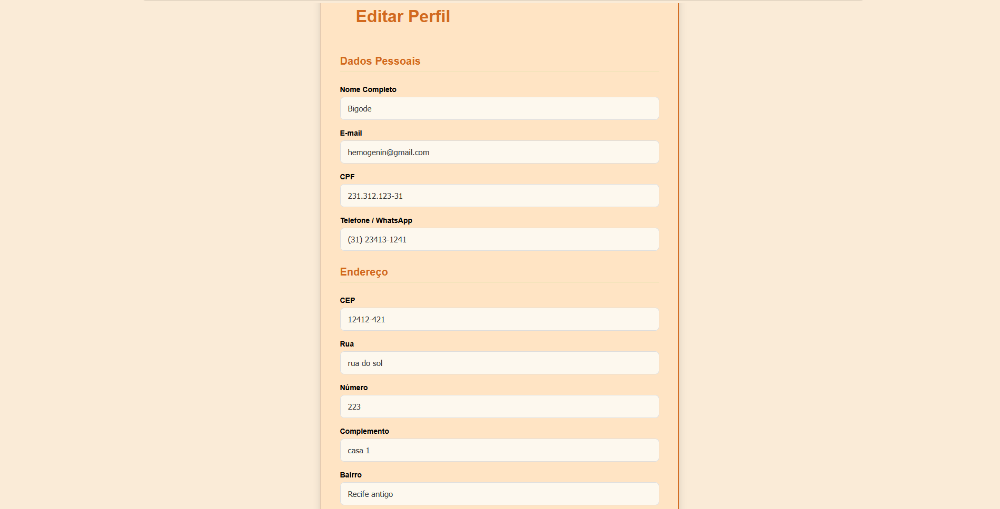
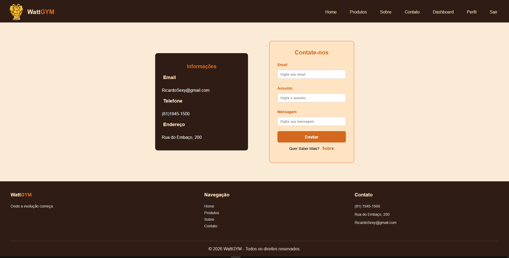
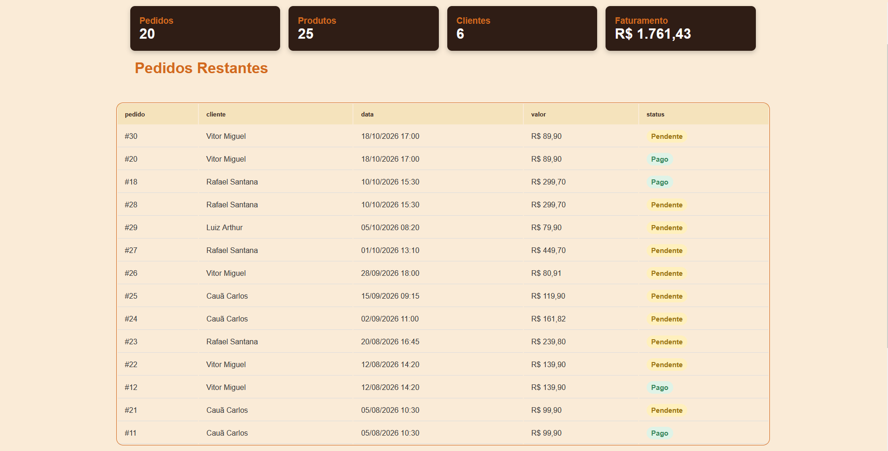

# Manual do usuário

Bem-vindo à WattGYM, a loja de produtos para academia. Este manual ensina, passo a passo, a usar o site. Não precisa saber de computação: é só seguir os passos.

## O que você encontra neste manual

- Como criar minha conta
- Como entrar e sair do site
- Como ver os produtos
- Como editar meus dados e meu endereço
- Como falar com a loja
- (Administrador) Como ver o painel da loja
- Perguntas frequentes

## O menu do site

No topo de todas as páginas fica o menu:

| Botão | Para que serve |
|-------|----------------|
| **Home** | Volta para a página inicial |
| **Produtos** | Mostra todos os produtos. Passando o mouse, aparecem as categorias |
| **Sobre** | Conta quem é a WattGYM |
| **Contato** | Para falar com a loja |
| **Login** | Para entrar no site (aparece só se você não entrou ainda) |
| **Perfil** e **Sair** | Aparecem depois que você entra |
| **Dashboard** | Aparece só para o administrador da loja |

## Como criar minha conta

Você só precisa criar a conta uma vez.

1. No menu, toque em **Login**.
2. Na tela de login, toque em **Cadastre-se**.
3. Preencha o seu **nome**.
4. Preencha a sua **data de nascimento**.
5. Digite o seu **e-mail**.
6. Crie uma **senha** com pelo menos 6 caracteres.
7. Digite a mesma senha de novo em **Confirmar senha**.
8. Toque em **Cadastrar**.

Pronto! Aparece a mensagem "Cadastro realizado com sucesso!". Toque em **Faça seu login aqui** para entrar.

 **Dica: para conferir o que digitou, toque no desenho do olho ao lado da senha. Toque de novo para esconder.**

 **Atenção: cada e-mail só pode ter uma conta. Se aparecer "Este e-mail já está cadastrado!", você já tem conta. Vá para o login.**

## Como entrar e sair do site

### Entrar

1. No menu, toque em **Login**.
2. Digite o seu **email**.
3. Digite a sua **senha**.
4. Toque em **Entrar**.

Pronto! Você vai para a página inicial, e o menu passa a mostrar **Perfil** e **Sair**.

Se aparecer "E-mail ou senha incorretos.", confira se digitou tudo certo. Cuidado com letras maiúsculas na senha.

### Sair

1. No menu, toque em **Sair**.

Você volta para a tela de login. Sempre saia do site quando usar um computador que não é seu.

## Como ver os produtos

1. No menu, toque em **Produtos**.
2. Role a página para ver todos os produtos. Cada um mostra a foto, o nome, uma descrição e o preço.
3. Para ir direto a uma categoria, passe o mouse sobre **Produtos** e escolha: **Suplementos**, **Acessórios**, **Creatinas**, **Pré-treinos** ou **Vitaminas**.

Na página inicial, em **Mais procurados**, você vê os destaques da loja.

> **Atenção:** o botão **Comprar** ainda não finaliza compras. A compra pelo site será liberada em breve.

## Como editar meus dados e meu endereço

Você precisa estar logado.

1. No menu, toque em **Perfil**.
2. Em **Dados Pessoais**, confira o seu nome, e-mail, CPF e telefone. Altere o que quiser.
3. Em **Endereço**, preencha o **CEP**, a **rua**, o **número**, o **complemento** (se tiver), o **bairro**, a **cidade** e a **UF** (a sigla do estado, como PE).
4. Toque em **Salvar Alterações**.

Pronto! Aparece "Alterações salvas com sucesso!" e os dados ficam guardados para a próxima vez.

Algumas informações importantes:

- O **CPF** e o **telefone** ganham pontinhos e traços sozinhos enquanto você digita. Não precisa se preocupar com isso.
- O CPF precisa ter 11 números, e o CEP, 8 números.
- Se você mudar o **telefone**, o site pergunta "Deseja salvar as alterações no telefone?". Toque em **OK** para confirmar.
- Se você preencher parte do endereço, o site avisa quais campos faltam.
- Nome e e-mail são obrigatórios. O resto pode ficar em branco.

 **Atenção: se aparecer "Este e-mail já está em uso por outra conta.", escolha outro e-mail.**

## Como falar com a loja

Você não precisa estar logado.

1. No menu, toque em **Contato**.
2. No formulário **Contate-nos**, digite o seu **e-mail**, para a loja saber onde responder.
3. Digite o **assunto**, por exemplo: "Dúvida sobre entrega".
4. Escreva a sua **mensagem**.
5. Toque em **Enviar**.

Pronto! Aparece "Mensagem enviada! Responderemos em breve."

Do lado esquerdo da tela, você também encontra o e-mail, o telefone e o endereço da loja.

## (Administrador) Como ver o painel da loja

Esta parte é só para quem administra a loja.

1. Entre no site com a sua conta de administrador.
2. No menu, toque em **Dashboard**.

No topo do painel, você vê quatro números:

| Número | O que significa |
|--------|-----------------|
| **Pedidos** | Quantos pedidos a loja já recebeu |
| **Produtos** | Quantos produtos estão cadastrados |
| **Clientes** | Quantas pessoas têm conta no site |
| **Faturamento** | Quanto a loja já ganhou, contando só os pedidos pagos, em transporte ou entregues |

Mais abaixo, a lista **Pedidos Restantes** mostra os pedidos que ainda não terminaram, com o número, o cliente, a data, o valor e o status.

Cada status tem uma cor:

| Status | Significa |
|--------|-----------|
| **Pendente** | O cliente fez o pedido, mas ainda não pagou |
| **Pago** | O pagamento foi confirmado |
| **Em Transporte** | O pedido saiu para entrega |

Pedidos **Entregues** e **Cancelados** não aparecem nessa lista.

 **Atenção: se você é cliente e tentar abrir o painel, o site leva você de volta para a página inicial. O painel é só para administradores.**

## Perguntas frequentes

**Esqueci minha senha. E agora?**
O site ainda não tem a opção de recuperar a senha. Entre em contato com a loja pela página **Contato**, ou crie uma conta nova com outro e-mail.

**Não consigo entrar, mesmo com o e-mail certo.**
Confira a senha, letra por letra. Se a sua conta foi criada antes do site pedir senha, ela não tem senha. Nesse caso, crie uma conta nova.

**Por que não aparece o botão Dashboard no meu menu?**
Porque ele é só para administradores da loja. Clientes não têm acesso.

**O botão Comprar não faz nada.**
É isso mesmo por enquanto. A compra pelo site ainda está sendo desenvolvida. Você já pode ver os produtos e os preços.

**Posso ter mais de um endereço?**
Por enquanto, a página de perfil guarda um endereço por pessoa.

**Preciso preencher o CPF?**
Não. O CPF é opcional no perfil. Se preencher, ele precisa ter 11 números.

**Quanto tempo a loja demora para responder minha mensagem?**
Responderemos em breve, no e-mail que você digitou no formulário de contato.