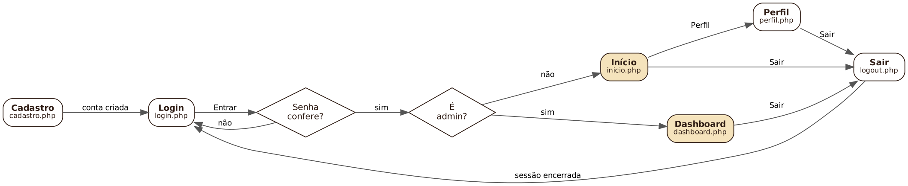

# Telas e fluxos 

O mapa do sistema: quais telas existem, quem pode abrir cada uma e para onde cada botão leva. No WattGYM, cada tela é um arquivo `.php` na raiz do projeto.

## Mapa de telas

| Tela | Arquivo | Quem acessa | O que faz |
|------|---------|-------------|-----------|
| Início | `inicio.php` | Todos | Página principal, com banner e os produtos mais procurados. O botão "Ver produtos" leva ao catálogo. |
| Produtos | `produtos.php` | Todos | Catálogo dividido por categoria (suplementos, creatinas, pré-treinos, vitaminas e acessórios). Os links do menu rolam até cada categoria. |
| Sobre | `sobre.php` | Todos | Quem somos, missão, visão e valores da loja. |
| Contato | `contato.php` | Todos | Mostra os dados da loja e o formulário "Contate-nos". Ao enviar, a mensagem é gravada em `mensagens_contato`. |
| Cadastro | `cadastro.php` | Visitante | Cria a conta (nome, nascimento, e-mail e senha). Quem já está logado vai para `inicio.php`. |
| Login | `login.php` | Visitante | Entra com e-mail e senha. Quem já está logado vai para `inicio.php`. |
| Perfil | `perfil.php` | Usuário logado | Edita dados pessoais e endereço. Sem login, vai para `login.php`. |
| Dashboard | `dashboard.php` | Administrador | Mostra pedidos, produtos, clientes, faturamento e pedidos em aberto. Sem login, vai para `login.php`. Cliente logado vai para `inicio.php`. |
| Usuários | `usuarios.php` | Administrador | Lista os usuários ativos com perfil e setor, busca por nome ou e-mail e mostra a caixa de confirmação de exclusão. |
| Novo usuário | `usuario_novo.php` | Administrador | Cadastra um usuário escolhendo perfil e setor em listas vindas do banco. |

### Arquivos que fazem parte de todas as telas

| Arquivo | Função |
|---------|--------|
| `header.php` | Topo e menu. Inicia a sessão e mostra os links certos: **Login** para visitante, **Perfil** e **Sair** para quem entrou, e **Dashboard** e **Usuários** só para administrador. |
| `footer.php` | Rodapé com navegação e contato. |
| `includes/config.php` | Conexão com o banco (PDO). Usado pelas páginas que consultam o banco. |
| `includes/funcoes.php` | Funções da gestão de usuários: confere se é administrador ativo, token CSRF, auditoria e avisos entre páginas. |
| `assets/CSS/style.css` | Visual do site. |
| `assets/JS/script.js` | Mostrar/ocultar senha, máscaras de CPF, telefone e CEP, e confirmação ao mudar o telefone. |
| `index.php` | Só redireciona para a página inicial. |

## Arquivos que processam dados

No WattGYM, cada formulário envia os dados para a **própria página** (`action` apontando para o mesmo arquivo). O PHP do topo do arquivo recebe, valida e grava, e depois a tela é mostrada de novo com a mensagem de sucesso ou de erro. Já `logout.php` não mostra tela: ele só encerra a sessão e redireciona.

| Arquivo | Método | Recebe | Faz | Redireciona para |
|---------|--------|--------|-----|------------------|
| `cadastro.php` | POST | nome, nascimento, e-mail, senha, confirmação | Valida os campos, confere se o e-mail já existe e grava o usuário em `usuarios`, com a senha criptografada (`password_hash`) | Fica na mesma tela, com a mensagem de sucesso e o link para o login |
| `login.php` | POST | e-mail, senha | Busca o usuário e confere a senha (`password_verify`). Se estiver certa, abre a sessão | `dashboard.php` (administrador) ou `inicio.php` (cliente). Com erro, fica no login |
| `logout.php` | GET | — | Limpa a sessão, apaga o cookie e destrói a sessão | `login.php` |
| `perfil.php` | POST | nome, e-mail, CPF, telefone, endereço | Valida, confere se o e-mail é de outra conta e atualiza `usuarios` e `enderecos` numa transação | Fica na mesma tela, com a mensagem |
| `contato.php` | POST | e-mail, assunto, mensagem | Valida e grava em `mensagens_contato` | Fica na mesma tela, com a mensagem |
| `usuario_novo.php` | POST | nome, e-mail, nascimento, senha, perfil, setor, token CSRF | Valida tudo no servidor (inclusive se perfil e setor existem e estão ativos), grava em `usuarios` e registra a auditoria | `usuarios.php`, já filtrando o usuário novo. Com erro, fica na mesma tela |
| `usuario_excluir.php` | POST | id do usuário, token CSRF | Confere método, permissão, token e id. Coloca o usuário em Baixa e registra a auditoria na mesma transação | `usuarios.php`, com aviso. Por GET devolve 405, sem token 403, com id inválido 400 |

## Fluxo principal: criar conta, entrar e sair

As duas verificações (losangos) são onde o PHP decide o caminho:

- **Senha confere?** O `login.php` compara a senha digitada com o hash guardado no banco. Se não bater, a pessoa volta ao login com o aviso "E-mail ou senha incorretos".
- **É admin?** Depois de entrar, o sistema olha o campo `tipo` do usuário. Administrador vai para o dashboard, e cliente vai para a página inicial.

A tela de **Perfil** só abre para quem está logado, e o **Dashboard** só para administradores. Nos dois casos, o PHP confere a sessão logo na primeira linha do arquivo, antes de mostrar qualquer coisa.

## Fluxo de edição do perfil

1. O usuário logado abre **Perfil**. O sistema busca os dados em `usuarios` e o primeiro endereço em `enderecos`.
2. O usuário altera os campos e clica em **Salvar Alterações**. Se o telefone mudou, o navegador pede uma confirmação.
3. O PHP valida: nome e e-mail obrigatórios, e-mail válido, CPF com 11 números, CEP com 8 números e, se houver endereço, os campos principais preenchidos.
4. Se algo estiver errado, a tela volta com o aviso e **mantém o que foi digitado**.
5. Se tudo estiver certo, grava `usuarios` e `enderecos` juntos (se uma das gravações falhar, nenhuma vale) e mostra "Alterações salvas com sucesso!".

## Fluxo de exclusão de usuário

1. O administrador abre **Usuários** e clica em **Excluir** na linha de um usuário. O link abre a mesma página com `?excluir=ID`, que mostra a caixa **"Deseja realmente excluir este usuário?"**, com nome, e-mail, perfil e ID.
2. **Cancelar** é só um link de volta para a lista. Nada é enviado, e o banco não muda.
3. **Confirmar** envia um POST para `usuario_excluir.php` com o ID e o token CSRF.
4. O PHP confere, nesta ordem: método POST, administrador ativo, token CSRF, ID válido, e se o administrador não está excluindo a si mesmo.
5. O PHP faz `UPDATE ... SET status = 'Baixa' ... WHERE status = 'Ativo'` e grava a auditoria na mesma transação. Se o usuário já estava em Baixa, nenhuma linha muda: o sistema avisa e registra a rejeição.
6. A lista é mostrada de novo, sem o usuário, com a mensagem de sucesso.

## Telas planejadas

Estas telas ainda não existem. Os botões **Comprar** do catálogo ainda não fazem nada.

| Tela | Arquivo (previsto) | O que fará |
|------|--------------------|------------|
| Carrinho | `carrinho.php` | Mostrar os itens, as quantidades e o total |
| Finalizar pedido | `finalizar.php` | Escolher endereço e forma de pagamento e gravar em `pedidos`, `itens_pedido` e `pagamentos` |
| Meus pedidos | `meus_pedidos.php` | Histórico e status dos pedidos do usuário |
| Gerenciar pedidos | dentro do dashboard | Mudar o status dos pedidos |

## Capturas de tela

Os prints de cada tela ficam em `docs/telas/` e são usados no manual do usuário: `cadastro.png`, `login.png`, `produtos.png`, `perfil.png`, `contato.png`, `dashboard.png`, `usuarios.png`, `usuario-novo.png` e `confirmar-exclusao.png`.
